# Spectre Ledger

Ledger provides durable storage and inspection at Spectre's persistence boundaries.
For Spectre 0.4, `Spectre.Ledger.ServerStore` stores AgentServer coordination state
and GAM journal values with CAS revisions. The file backend provides checksums,
synced writes and atomic compaction; the PostgreSQL backend uses a host-owned
Ecto Repo, asynchronous queries and indexed pages without caching historical rows. It is a storage port; it does not become another agent runtime.

The package also retains **separate Instance checkpoint and receipt archives**,
Memory/PostgreSQL adapters and verified bundles. Those append-only archive APIs
are useful directly, but their formats and options are not the AgentServer Store.

## Where Ledger fits

The Server owns execution and checkpoints; GAM owns authority and admission.
Ledger supplies their storage ports. With PostgreSQL, one application-owned Repo
can serve coordination state, canonical GAM history and its derived read model:



[Diagram source](docs/assets/readme-architecture.mmd).

This is the `gam: [storage: :ledger]` configuration described in the
[database setup guide](docs/SPECTRE_0_4.md). The file-backed example below instead
uses a compacting coordination log and a separate GAM directory. Without a
persistent projection adapter, Spectre can continue in its ordinary RAM mode.

## Installation on the 0.4 development branch

This branch targets the **unreleased Spectre 0.4 architecture**. Use matching Git
branches; the examples do not assume that Spectre 0.4 is available from Hex.
For reproducible deployments, replace branch selectors with reviewed commit refs.

```elixir
def deps do
  [
    {:spectre, github: "elchemista/spectre",
     branch: "feature/agent-server-gam", override: true},
    {:spectre_ledger, github: "elchemista/spectre_ledger",
     branch: "feature/stack-tools-0.4"}
  ]
end
```

The manifest requirement `{:spectre, "~> 0.4.0"}` describes compatibility, not
publication availability. Local contributors can use `SPECTRE_PATH=../spectre` for this repository's dependency override.

## Persist and inspect an AgentServer

```elixir
defmodule MyApp.AI do
  use Spectre.Stack
  install Spectre.Ledger
end

defmodule MyApp.SupportServer do
  use Spectre.Server, tools: MyApp.AI

  def handle_flow({:support, :checkpoint}, _input, ctx),
    do: ledger(ctx, {:head}, on_result: :checkpoint)

  def handle_result(:checkpoint, {:ok, head}, ctx),
    do: respond(ctx, "Checkpoint revision #{head.revision}: #{head.bytes} bytes")

  def handle_result(tag, result, ctx), do: super(tag, result, ctx)
end

defmodule MyApp.SupportAgent do
  use Spectre.Agent, stack: MyApp.AI, server: MyApp.SupportServer
  flow :support do
    on :checkpoint, regex: ~r/^checkpoint$/i
  end
end

{:ok, store} = Spectre.Ledger.ServerStore.start_link(path: "data/support.ledger")
{:ok, server} = Spectre.Server.start_link(
  agent: MyApp.SupportAgent,
  identity: %{subject: "conversation-42"},
  gam: [storage: {:disk, "data/support-gam/conversation-42"}],
  checkpoint: {Spectre.Ledger.ServerStore, store, {:support, "conversation-42"}},
  consumer: self())
{:ok, interaction} = Spectre.Server.input(server, "checkpoint")
```

Put both processes under your supervision tree in an application. The stable
identity and durable GAM directory preserve matching authority and coordination
history across restarts; an external checkpoint must not use an ephemeral GAM
ledger. `head` returns
only `%{revision: ..., digest: ..., bytes: ...}` for this Server's checkpoint.
It does not copy saved messages, candidates or assigns into a tool result. Explicit
foreign keys are rejected. `{:entries}` returns metadata, not an immutable audit trail.

## A native revisioned Store

```elixir
{:ok, revision} = Spectre.Ledger.ServerStore.put_new(store, :example, %{value: 1})
{:ok, next_revision} = Spectre.Ledger.ServerStore.compare_and_swap(
  store, :example, revision, %{value: 2})
{:ok, %{revision: ^next_revision, value: %{value: 2}}} =
  Spectre.Ledger.ServerStore.fetch(store, :example)
:ok = Spectre.Ledger.ServerStore.delete(store, :example, next_revision)
:ok = Spectre.Ledger.ServerStore.compact(store)
```

Revision tokens are opaque and monotonic; a new key need not start at 1.
Compaction removes superseded values and deleted keys from memory and disk while a
global sequence prevents stale CAS tokens matching recreated keys. It runs automatically
at append capacity and can be scheduled explicitly. Live values must still fit capacity
(default 256 MiB). Writes, initialization and compaction use durability barriers;
reads wait for a busy Store. Corrupt/torn logs fail closed for operator inspection.

Compaction is not forensic erasure of filesystem snapshots or backups. The
[Store and recovery guide](docs/SPECTRE_0_4.md) covers format upgrades, GAM journal
configuration, Stack-owned resources and the distinct legacy archive contracts.

Configured Ledger Stack resources are discovered automatically for Managed GAM
coordination and approval inboxes. Database history is retained; there is no
automatic expiry purge or mandatory inbox quota. See the
[PostgreSQL setup and policy guide](docs/SPECTRE_0_4.md#postgresql-coordination-store-and-approval-inbox).
With `gam: [storage: :ledger]`, `gam_domain/1` supplies canonical GAM history and
the Domain's persisted read model on the same Repo. Individual Domain records
remain queryable after shutdown; restart rebuilds them from verified history.
Install both sets of tables first; [setup and projection limits](docs/SPECTRE_0_4.md#canonical-gam-history-in-postgresql).

Multiple root AgentServers can share one Stack resource and Ecto Repo. Give
each logical agent a distinct stable `identity`; Managed GAM derives its Domain
and default checkpoint key from that identity and the Agent definition. Reusing
the same identity selects the same persisted namespace for recovery, rather
than allocating another agent. The supervision child `id:` only identifies a
child in its supervisor; it does not separate database records. Applications
that override `gam: [domain: ...]` or the checkpoint key own their uniqueness.
Size the Repo pool and storage worker budget for the expected concurrent work;
neither requires one database connection or one Repo per agent.

## Documentation

- [AgentServer integration, helpers and authority](docs/SPECTRE_0_4.md)
- [Migration from the 0.3 integration](docs/MIGRATING_TO_0_4.md)
- [Standalone and retained runtime reference](docs/INSTANCE_ARCHIVES.md)
- [Public API](docs/PUBLIC_API.md) and [changelog](CHANGELOG.md)
- [Governed Act Model](https://spectre.guide/en/governed-act-model) and [core tool lifecycle](https://github.com/elchemista/spectre/blob/feature/agent-server-gam/docs/STACK_TOOLS.md)

## Use inside a reusable Skill

The generated `ledger` helper also works in Skill Server callbacks using the same
Stack. Each mount has its own process, state and checkpoint; governed operations
share the root AgentServer's GAM Domain and must satisfy both root operations
and mount `governed:` permissions. Ledger and Lab helpers inspect only the calling Server checkpoint. See the
[core Skill guide](https://github.com/elchemista/spectre/blob/feature/agent-server-gam/docs/SKILLS.md) for ownership and consent.

## Contributing

Use Elixir 1.19 and OTP 28 with a matching core checkout:

```sh
export SPECTRE_PATH=../spectre
mix deps.get
mix test
mix credo
mix dialyzer
mix docs --warnings-as-errors
```

PostgreSQL tests create an isolated temporary cluster. Install PostgreSQL tools
and make `initdb` and `pg_ctl` available on `PATH`; no application database is used.
See [profiling and operational setup](docs/SPECTRE_0_4.md) before changing storage.

## Examples

The [LiveView playground](https://github.com/elchemista/demo_spectre) demonstrates
Spectre and its packages. [spectre.guide](https://spectre.guide) explains GAM and
provides usage articles. Package versions are independent of Spectre core.
